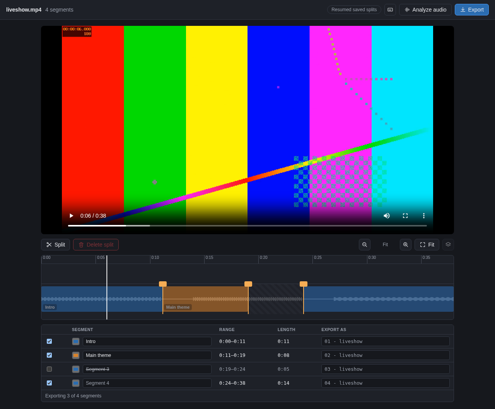

# split-video

An agent-first editor for long recordings (streams, gigs, lectures): find the songs, highlights and
moments, then cut, compose and render them as separate files or vertical shorts. Everything is also
available from a browser editor, a CLI, an MCP server and an HTTP API.



## Quick start

No Python, uv or ffmpeg setup needed. Mount the folder your recordings live in and open the editor:

```bash
docker run --rm -p 8765:8765 -v "$PWD":/data ghcr.io/leejianrong/split-video \
  edit /data --host 0.0.0.0 --no-browser
```

Then open <http://localhost:8765> and pick a video. In a clone of this repo, `make dev` builds the
image locally and does the same (`make dev DIR=~/recordings PORT=9000` to change the folder or port).

Split a recording by its silence gaps from the command line, no browser involved (always `--dry-run` first):

```bash
docker run --rm -v "$PWD":/data ghcr.io/leejianrong/split-video split liveshow.mp4 --dry-run
docker run --rm -v "$PWD":/data ghcr.io/leejianrong/split-video split liveshow.mp4
```

Files and `manifest.json` land in `liveshow_split/` next to the source. More Docker options (file ownership
on Linux, API token, building the image): [docs/docker.md](docs/docker.md). Without Docker: `uv sync` and
`uv run split-video ...`, see [docs/cli.md](docs/cli.md#run-without-docker-uv).

## What you can do

- **Split a recording by silence** into one file per song: [docs/cli.md](docs/cli.md).
- **Adjust splits visually**: video player, zoomable waveform timeline, segment table, optional audio
  classification: [docs/editor.md](docs/editor.md).
- **Compose**: combine clips from several files with overlays, titles, music, crossfades, export presets and
  captions, in the editor or as `split-video compose ...`: [docs/compose.md](docs/compose.md).
- **Let an agent find highlights and make vertical shorts** over MCP (55 tools), the CLI or the HTTP API: import,
  report, transcribe, pick moments, plan, render. Start with the
  [agent guide](src/split_video/agent_guide/SKILL.md) (`split-video agent-guide` prints it) and
  [docs/mcp.md](docs/mcp.md).
- **Optional extras**, built into the image with build args: speech to text
  (`--build-arg WITH_TRANSCRIPTION=1`) and on-screen text OCR (`--build-arg WITH_OCR=1`); see
  [docs/analysis.md](docs/analysis.md).

Add the MCP server to an agent (tools only touch files under `--root`):

```bash
claude mcp add split-video -- docker run -i --rm -v ~/recordings:/data \
  ghcr.io/leejianrong/split-video mcp --root /data
```

## Docs

| | |
|---|---|
| [docs/docker.md](docs/docker.md) | Running and building the image, `make dev` |
| [docs/cli.md](docs/cli.md) | `split`, project commands, running without Docker |
| [docs/editor.md](docs/editor.md) | The visual editor |
| [docs/frontend.md](docs/frontend.md) | The new Svelte editor (scaffold at `/app/`), building it, the dev loop |
| [docs/compose.md](docs/compose.md) | Compose, edit plans, edit operations |
| [docs/library.md](docs/library.md) | Library scan, proxies, thumbnails |
| [docs/analysis.md](docs/analysis.md) | Transcription, scenes, frames, OCR, search, report, highlights |
| [docs/mcp.md](docs/mcp.md) | The MCP server |
| [docs/api.md](docs/api.md) | HTTP API (`/api/v1`, [openapi.json](openapi.json)) and API token |
| [docs/revisions.md](docs/revisions.md) | Editing one project from several places |
| [docs/errors.md](docs/errors.md) | Error codes (generated) |
| [docs/edit-plan.md](docs/edit-plan.md), [docs/edit-ops.md](docs/edit-ops.md) | Edit plan and edit operation formats |
| [docs/highlights.md](docs/highlights.md), [docs/media-report.md](docs/media-report.md), [docs/time-index.md](docs/time-index.md) | Highlight scoring, media report and time index formats |
| [docs/render-queue.md](docs/render-queue.md), [docs/tool-response-caps.md](docs/tool-response-caps.md) | Render queue, tool response size limits |
| [docs/e2e-agent-test.md](docs/e2e-agent-test.md) | The end-to-end agent test |
| [docs/ux-spec.md](docs/ux-spec.md) | UX spec for the unified editor (design contract for M3) |
| [docs/adr/](docs/adr/), [docs/decisions/](docs/decisions/) | Architecture decisions and design notes |

## Contributing

See [CONTRIBUTING.md](CONTRIBUTING.md) for tests, the pre-push hook and releases. Questions or bugs: open a
[GitHub issue](https://github.com/leejianrong/split-video/issues).

## License

[Apache License 2.0](LICENSE).
